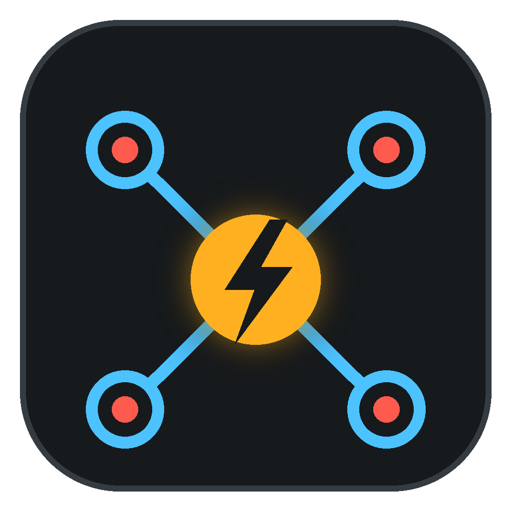
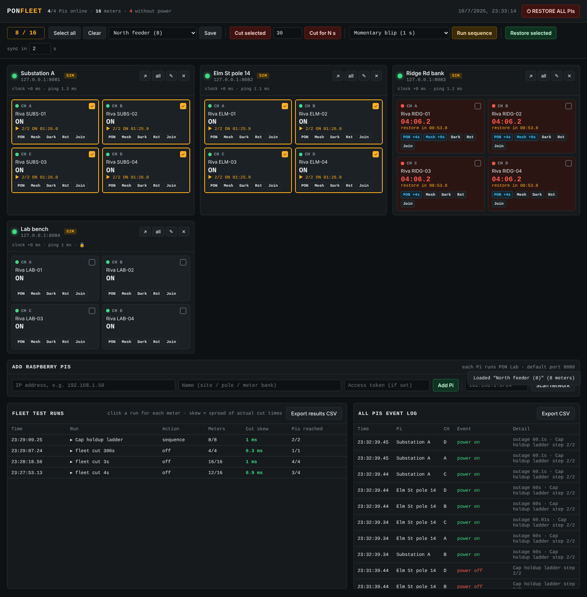
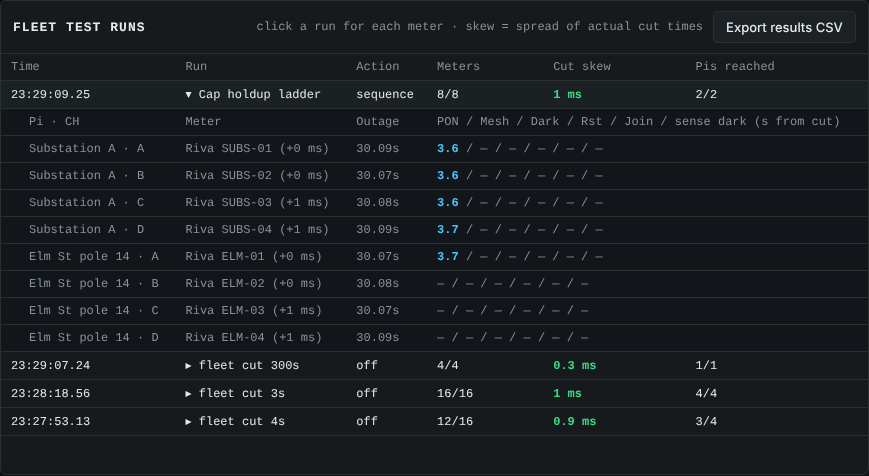
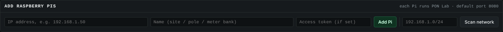
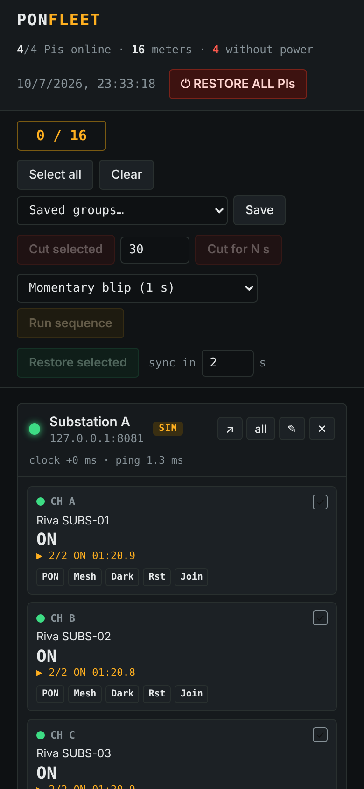

<p align="center"></p>

# PON Fleet: control many PON Lab Pis at once

One server that controls every [PON Lab](https://github.com/hardwaremack-prog/ponlab)
Raspberry Pi you've deployed. Pick **up to 16 meters** across any number of Pis and
cut, restore or run a test sequence on **all of them at the same moment**. Then see
the PON, mesh and supercap results for every meter in one table.



| Results per meter, with cut skew | Adding Pis | Phone view |
|---|---|---|
|  |  |  |

## What it does

- **Add Pis by IP address**, or **scan your network** to find every PON Lab Pi.
- **See every meter live.** Each tile shows power on/off, the outage timer and the
  sequence step. A Pi that drops offline is flagged.
- **Pick up to 16 meters** across any Pis. Save picks as **groups**, for example
  "North feeder" or "Ridge Rd bank".
- **Synchronized actions:**
  - **Cut selected** stays off until you restore.
  - **Cut for N s** restores automatically on each Pi.
  - **Run sequence** runs presets on all selected meters together: blip,
    sustained 5 min / 30 min, cap holdup ladder, recloser, flicker.
  - **Restore selected** and **RESTORE ALL PIs**.
- **Lined-up timing.** PON Fleet measures each Pi's clock offset and sends a
  "fire at" time (2 s ahead by default). Every Pi switches at the same instant,
  and each run shows the **cut skew**: how many ms apart the cuts actually landed.
- **One-tap marks on every meter:** PON, Mesh lost, Dark (caps out), Restore
  notice, Rejoined. Each is stamped in seconds from that meter's cut.
- **Fleet test runs table.** Each run expands to show every meter's results.
  **Export results CSV** gives one row per meter per run, and there's a combined
  event log CSV.
- **Safe by design.**
  - Each Pi enforces its own maximum outage, so it restores even if the fleet
    server or network goes down.
  - Each Pi's fail-safe NC wiring keeps meters powered if a Pi dies.
  - An optional **access token** per Pi means only your server can switch relays.

## Quick start

On any computer that can reach the Pis (Windows, Mac, Linux or another Pi):

```bash
pip install flask        # Pi OS: sudo apt install python3-flask
python3 fleet.py --open  # http://localhost:8090
```

On Windows, double-click **Start PON Fleet.bat**.
On a Pi you want running all the time: `sudo ./install.sh`, which starts it on boot.

Then click **Add Pi**, or **Scan network** with your subnet (for example
`192.168.1.0/24`).

## Setting up the Pis

Each Pi runs PON Lab with its relays and contactors. See
[PON Lab HARDWARE.md](https://github.com/hardwaremack-prog/ponlab/blob/main/HARDWARE.md).
In each Pi's `config.json`:

```json
"node_name": "Elm St pole 14",
"api_token": "pick-a-long-shared-secret"
```

Put the same token into PON Fleet with the ✎ button on that Pi.

**Pis in the field.** PON Fleet only needs to reach each Pi's port 8080. On one
LAN that just works. For Pis at different sites, use a VPN such as Tailscale or
WireGuard, or a site router with a static route. Don't expose port 8080 to the
open internet.

## How "at the same time" works

1. Every 30 s PON Fleet pings each Pi a few times and works out that Pi's clock
   offset from the quickest ping.
2. When you press **Cut**, it picks a moment 2 s from now (the **sync in**
   setting), converts it to each Pi's own clock, and sends every Pi one message
   for all of its selected channels.
3. Each Pi waits for that moment, then switches all its relays together.
4. Each Pi logs the real switch time. PON Fleet converts those times back and
   reports the spread as **cut skew**.

On a LAN, expect a few milliseconds of skew. The contactors add roughly 10–20 ms
of mechanical release time on top.

## Files

- `fleet.py` is the server (Flask + Python standard library).
- `static/index.html` is the dashboard.
- `fleet-config.json` sets port, `max_targets` (16), presets and mark buttons.
- `data/` holds your Pis, groups and run history.
- `Start PON Fleet.bat` / `start-fleet.sh` / `install.sh` are the launchers.
